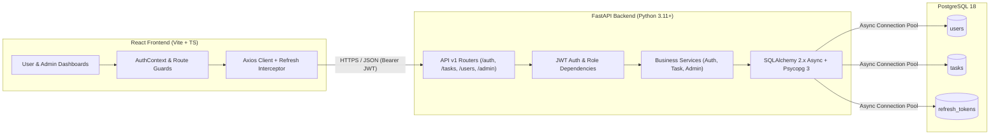

# System Architecture & Production Deployment Guide

## 1. High-Level Architecture



---

## 2. Key Architectural Decisions & Security Boundaries

### A. Authentication & Token Storage Strategy
- **Access Tokens**: Short-lived (15 minutes) stateless JWTs containing `sub` (user UUID), `role`, and `type: "access"`.
- **Refresh Tokens**: 7-day JWTs whose **SHA-256 hash** (`token_hash`) is persisted in the `refresh_tokens` table. Raw refresh tokens are never stored in the database.
- **Session Revocation**: Logging out marks the database session row as `revoked = TRUE`, immediately preventing further token refreshes.
- **Password Security**: All passwords are hashed using `bcrypt` (`passlib[bcrypt]`) before storage.

### B. Authorization & Data Isolation
- **Strict Task Ownership**: Every task query (`GET`, `PATCH`, `DELETE`) in [`TaskService`](file:///d:/Todolist/backend/app/services/task_service.py) includes `WHERE Task.user_id == current_user.id`. Attempting to access another user's task UUID returns `404 Not Found` without leaking whether the UUID exists.
- **Admin Permissions**: Admin endpoints (`/api/v1/admin/*`) enforce `current_user.role == UserRole.ADMIN` via [`get_current_admin`](file:///d:/Todolist/backend/app/core/deps.py). Public registration (`POST /api/v1/auth/register`) hardcodes `role = UserRole.USER` to prevent privilege escalation/mass-assignment. Administrators can view system-wide aggregated task counts and manage user activation status (`is_active`), while individual user task contents remain private to their owners.

### C. Database Performance & Integrity
- **Database-Side Filtering & Pagination**: Task filtering (`status`, `priority`, `ILIKE` title search), sorting, and statistical summaries (`COUNT ... FILTER`) are executed inside PostgreSQL using composite indexes (`idx_tasks_user_status_priority_created`, `idx_tasks_user_due_date`).
- **Windows Async Compatibility**: `psycopg 3` async connections require `WindowsSelectorEventLoopPolicy` on Windows, configured automatically in [`run.py`](file:///d:/Todolist/backend/run.py) and [`session.py`](file:///d:/Todolist/backend/app/db/session.py).

---

## 3. Production Deployment Guide

### A. Environment Variables & Secrets
1. Copy [`.env.example`](file:///d:/Todolist/.env.example) to `.env`.
2. Generate a cryptographically strong 256-bit `JWT_SECRET_KEY`:
   ```powershell
   python -c "import secrets; print(secrets.token_hex(32))"
   ```
3. Set `ENVIRONMENT=production` (automatically disables `/docs` and `/redoc` public exposure in production) and configure `ALLOWED_ORIGINS` to your production frontend domain (e.g., `https://todo.yourdomain.com`).

### B. Running with Docker Compose
```powershell
docker compose up -d --build
```
- **PostgreSQL (`db`)**: Uses persistent volume `postgres_data`, initializes schema from `database/init/`, and runs a `pg_isready` health check before the backend starts. Do not expose port `5432` to the public internet in production.
- **FastAPI (`backend`)**: Runs on port `8000` behind your reverse proxy or load balancer, with `/health` configured for readiness probes.
- **React (`frontend`)**: Multi-stage build compiling static assets with Vite and serving via Nginx (`port 80/443`).

### C. Backup & Recovery
- **Automated Logical Backups**:
  ```powershell
  pg_dump -U postgres -h 127.0.0.1 -F c -f todo_app_backup.dump todo_app
  ```
- **Restore**:
  ```powershell
  pg_restore -U postgres -h 127.0.0.1 -d todo_app --clean todo_app_backup.dump
  ```

