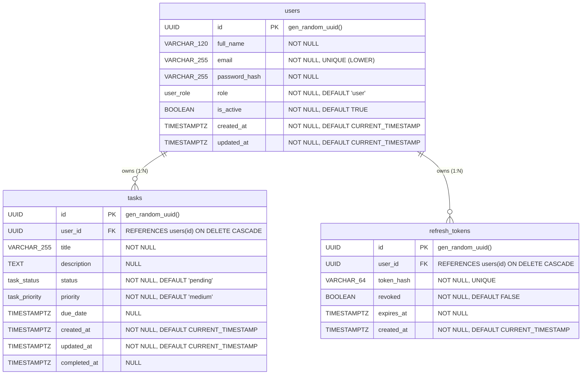

# Database Schema & Data Dictionary

## 1. Entity-Relationship (ER) Diagram

---

## 2. Table Specifications and Data Dictionary

### 2.1 Table: `users`

Represents application users (both regular users and administrators).

| Column Name | Type | Modifiers / Constraints | Description |
| :--- | :--- | :--- | :--- |
| `id` | `UUID` | `PRIMARY KEY DEFAULT gen_random_uuid()` | Unique immutable identifier for the user. Avoids sequential ID enumeration attacks. |
| `full_name` | `VARCHAR(120)` | `NOT NULL`, `CHECK(length(trim(full_name)) > 0)` | User's full name. Must not be empty or whitespace-only. |
| `email` | `VARCHAR(255)` | `NOT NULL`, regex check, `UNIQUE (LOWER(email))` | Primary login credential. Validated with format regex and case-insensitive unique index. |
| `password_hash` | `VARCHAR(255)` | `NOT NULL` | Cryptographic hash (Argon2id or bcrypt). Plaintext passwords are never stored. |
| `role` | `user_role` (`ENUM`) | `NOT NULL DEFAULT 'user'`, values: `'admin'`, `'user'` | Role-based authorization tier. Enforced strictly at the database level. |
| `is_active` | `BOOLEAN` | `NOT NULL DEFAULT TRUE` | Soft-deactivation / account suspension flag. |
| `created_at` | `TIMESTAMPTZ` | `NOT NULL DEFAULT CURRENT_TIMESTAMP` | UTC timestamp of record creation. |
| `updated_at` | `TIMESTAMPTZ` | `NOT NULL DEFAULT CURRENT_TIMESTAMP` | UTC timestamp of record last modification (maintained by trigger). |

#### Indexes on `users`:
- `users_pkey`: Primary key index on `id`.
- `uq_users_email_lower`: Unique index on `LOWER(email)` preventing duplicates like `User@example.com` and `user@example.com`.
- `idx_users_email_active`: Partial index on `(LOWER(email)) WHERE is_active = TRUE` for high-throughput login queries.

---

### 2.2 Table: `tasks`

Represents to-do items owned exclusively by a specific user.

| Column Name | Type | Modifiers / Constraints | Description |
| :--- | :--- | :--- | :--- |
| `id` | `UUID` | `PRIMARY KEY DEFAULT gen_random_uuid()` | Unique immutable task identifier. |
| `user_id` | `UUID` | `NOT NULL`, `REFERENCES users(id) ON DELETE CASCADE` | Foreign key referencing the owning user. Every task must have an owner. |
| `title` | `VARCHAR(255)` | `NOT NULL`, `CHECK(length(trim(title)) > 0)` | Task title / brief summary. |
| `description` | `TEXT` | `NULL` | Detailed task markdown or notes. |
| `status` | `task_status` (`ENUM`) | `NOT NULL DEFAULT 'pending'`, values: `'pending'`, `'in_progress'`, `'completed'` | Lifecycle status of the task. |
| `priority` | `task_priority` (`ENUM`) | `NOT NULL DEFAULT 'medium'`, values: `'low'`, `'medium'`, `'high'` | Task priority level. |
| `due_date` | `TIMESTAMPTZ` | `NULL` | Optional task deadline stored in UTC. |
| `created_at` | `TIMESTAMPTZ` | `NOT NULL DEFAULT CURRENT_TIMESTAMP` | UTC creation timestamp. |
| `updated_at` | `TIMESTAMPTZ` | `NOT NULL DEFAULT CURRENT_TIMESTAMP` | UTC update timestamp (maintained by trigger). |
| `completed_at` | `TIMESTAMPTZ` | `NULL` | Timestamp when the task was finished. Enforced by check constraint. |

#### Check Constraints on `tasks`:
- `chk_tasks_title_not_empty`: Disallows empty or pure-whitespace titles.
- `chk_tasks_status_completed_at`: Enforces business logic integrity:
  $$(status = 'completed' \land completed\_at \text{ IS NOT NULL}) \lor (status \ne 'completed' \land completed\_at \text{ IS NULL})$$

#### Indexes on `tasks`:
- `tasks_pkey`: Primary key index on `id`.
- `idx_tasks_user_id`: Essential foreign key index preventing full table scans when cascading deletes or listing by owner.
- `idx_tasks_user_status_priority_created`: Composite index `(user_id, status, priority, created_at DESC)` optimized for user dashboard filtering and pagination.
- `idx_tasks_user_due_date`: Composite index `(user_id, due_date ASC NULLS LAST)` for schedule/calendar queries.

---

### 2.3 Table: `refresh_tokens`

Session store for JWT refresh token rotation, replay prevention, and secure revocation.

| Column Name | Type | Modifiers / Constraints | Description |
| :--- | :--- | :--- | :--- |
| `id` | `UUID` | `PRIMARY KEY DEFAULT gen_random_uuid()` | Unique session identifier. |
| `user_id` | `UUID` | `NOT NULL`, `REFERENCES users(id) ON DELETE CASCADE` | Foreign key referencing token owner. |
| `token_hash` | `VARCHAR(64)` | `NOT NULL UNIQUE` | SHA-256 digest of the refresh token secret string. Raw token is never stored in DB. |
| `revoked` | `BOOLEAN` | `NOT NULL DEFAULT FALSE` | Set to TRUE on explicit logout or replay detection. |
| `expires_at` | `TIMESTAMPTZ` | `NOT NULL` | UTC expiration timestamp for session validity checks. |
| `created_at` | `TIMESTAMPTZ` | `NOT NULL DEFAULT CURRENT_TIMESTAMP` | UTC timestamp of session issuance. |

#### Justification for `refresh_tokens`:
Stateless JWT access tokens are intentionally short-lived (e.g. 15 minutes) for security. Storing cryptographic digests of refresh tokens enables:
1. Refresh token rotation (each refresh generates a new token and invalidates the previous one).
2. Explicit server-side revocation on logout (impossible with pure stateless JWTs).
3. Automatic cleanup via cascading deletes when an account is deleted.

